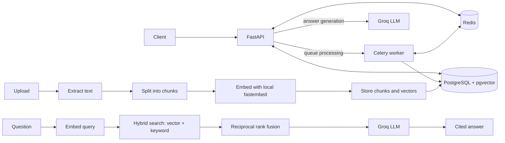

# DocMind

**A multi-tenant document search and question-answering API with cited answers.**

`FastAPI` · `PostgreSQL + pgvector` · `Celery` · `Redis` · `fastembed` · `Groq` · `Docker Compose`

Live demo: **TODO — not deployed yet**

## What it does

DocMind accepts PDF and DOCX uploads and processes them in a background Celery worker. It extracts text, splits it into chunks, creates local 384-dimensional embeddings, and stores the content and vectors in PostgreSQL with pgvector. Authenticated users can search their tenant’s documents or ask questions and receive answers with source citations. Tenant-scoped access controls apply to documents, search, answers, history, and usage metrics.

## Architecture



## Features

- Tenant isolation for documents and queries.
- JWT bearer authentication and user API keys.
- Hybrid retrieval combining vector and PostgreSQL keyword search with reciprocal rank fusion.
- Question answering with citations from retrieved document chunks.
- Per-tenant duplicate upload detection using file content hashes.
- Reprocessing for failed or stalled documents.
- Redis-backed rate limits (10 auth requests/min per IP, 30 search/ask requests/min per user) and a rolling 24-hour query quota (default 1,000 per tenant).
- Tenant-aware query history and usage metrics.
- Request IDs in responses and structured access log lines.

## Quick start

1. Clone the repository and enter its directory:

   ```sh
   git clone <repository-url>
   cd DocMind
   ```

2. Copy the example environment file and set a Groq API key:

   ```sh
   cp .env.example .env
   ```

   Set `GROQ_API_KEY` in `.env`. Replace the example `SECRET_KEY` with a strong value before using the service beyond local development.

3. Build and start the containers:

   ```sh
   docker compose up --build
   ```

4. Open the interactive API documentation at `http://localhost:8000/docs`.

   The first document upload takes about a minute while the local embedding model downloads.

## API overview

All API routes below are under `/api/v1`.

| Method | Path | Purpose |
|---|---|---|
| GET | `/` | Service information and documentation path. |
| GET | `/health` | Basic service health. |
| GET | `/health/detailed` | Database, Redis, and worker health checks. |
| POST | `/auth/register` | Register a tenant and its initial user. |
| POST | `/auth/login` | Obtain an access token (form fields: username = email, password). |
| GET | `/auth/me` | Return the authenticated user. |
| POST | `/auth/api-key` | Create or replace the authenticated user’s API key. |
| DELETE | `/auth/api-key` | Revoke the authenticated user’s API key. |
| POST | `/documents/upload` | Upload a PDF or DOCX for background processing. |
| GET | `/documents/` | List the current tenant’s documents. |
| GET | `/documents/{document_id}` | Get a tenant-owned document. |
| DELETE | `/documents/{document_id}` | Delete a tenant-owned document. |
| POST | `/documents/{document_id}/reprocess` | Requeue an eligible failed or stalled document. |
| GET | `/documents/{document_id}/chunks` | List a document’s chunks with pagination. |
| GET | `/documents/{document_id}/chunks/{chunk_index}` | Get one chunk by its index. |
| POST | `/search` | Search tenant documents; supports vector, keyword, and hybrid modes. |
| POST | `/ask` | Ask a question and receive an answer with citations. |
| GET | `/history` | List visible question-and-answer history. |
| GET | `/history/{log_id}` | Get one visible history entry. |
| DELETE | `/history/{log_id}` | Delete one visible history entry. |
| GET | `/metrics/usage` | Get tenant document, chunk, query, and latency metrics. |

Protected routes accept a JWT bearer token or `X-API-Key` header as applicable. Request and response schemas are available in `/docs`.

## Configuration

Values below reflect `.env.example` and application defaults where applicable.

| Variable | Example/default | Purpose |
|---|---|---|
| `APP_NAME` | `DocMind` | Application name used by the service. |
| `APP_ENV` | `development` | Runtime environment label. |
| `SECRET_KEY` | `your-secret-key-here-change-in-production` | Secret used for signing access tokens; replace it. |
| `POSTGRES_USER` | `docmind` | PostgreSQL username. |
| `POSTGRES_PASSWORD` | `docmind_password` | PostgreSQL password. |
| `POSTGRES_DB` | `docmind_db` | PostgreSQL database name. |
| `POSTGRES_HOST` | `db` | PostgreSQL hostname in Compose. |
| `POSTGRES_PORT` | `5432` | PostgreSQL container port. |
| `DATABASE_URL` | `postgresql+asyncpg://docmind:…@db:5432/docmind_db` | Async SQLAlchemy database URL. |
| `REDIS_URL` | `redis://redis:6379/0` | Redis connection used by the application. |
| `CELERY_BROKER_URL` | `redis://redis:6379/0` | Celery message broker URL. |
| `CELERY_RESULT_BACKEND` | `redis://redis:6379/1` | Celery result backend URL. |
| `MAX_FILE_SIZE_MB` | `50` | Maximum accepted upload size in megabytes. |
| `UPLOAD_DIR` | `/tmp/docmind_uploads` | Directory where uploaded files are stored. |
| `GROQ_API_KEY` | *(required for answer generation)* | API key used for Groq chat completions. |
| `LLM_MODEL` | `openai/gpt-oss-20b` | Chat model name; use any model your Groq key can access. |
| `CORS_ORIGINS` | `http://localhost:3000` | Comma-separated allowed browser origins. |

The embedding model runs locally through fastembed; it does not require an embedding API key.

## Testing

Run the test suite inside the API container:

```sh
docker exec docmind_api pytest -q
```

Run tests with coverage and a missing-lines report:

```sh
docker exec docmind_api pytest --cov=app --cov-report=term-missing -q
```

Current suite: 84 tests, 81% coverage.

## Design decisions

- Embeddings use local fastembed (`all-MiniLM-L6-v2`, 384 dimensions), avoiding a paid embedding API.
- The Celery worker uses SQLAlchemy `NullPool`; each task uses `asyncio.run`, which creates a new event loop, so pooled async connections must not cross task loops.
- API and worker share the uploads volume so the worker can read files written by the API container.
- Rate limiting fails open when Redis is unavailable, allowing requests to continue during a Redis outage.
- Cross-tenant resource lookups return 404 rather than 403 so the API does not reveal whether another tenant’s resource exists.

## Known limitations

- Startup uses SQLAlchemy `create_all()` for schema creation; Alembic migrations are not yet implemented.
- Scanned PDFs do not receive OCR, so extraction requires selectable text.
- The service is designed as a single-region deployment; multi-region operation is not implemented.
- Tests run against the development database.
- Uploaded files are stored on a Docker volume under `/tmp` rather than object storage.
